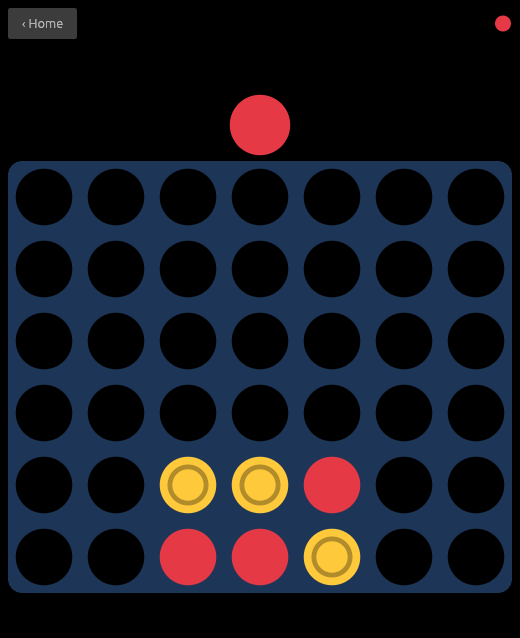

# 5. vier-desktop

vier-desktop is Vier in a window, written in Rust. You point at a column and a
red disc hovers over it, you click and the disc falls, and the computer slides
its yellow disc across and drops it. It plays against the computer or a second
person, and like vier-cli, it picks up a game you didn't finish. It's about
seventeen hundred lines counting its tests, and fourteen hundred without them.

This chapter and the next read it. This one gets it running, finds the pieces,
and reads the board and the rules, which are the parts that look most like your
lux game. Chapter 6 reads the parts chapter 4 prepared you for: the frame, the
phases, and one click followed all the way through.

## 5.1 Running it

```text
git clone https://github.com/anderix/vier-desktop
cd vier-desktop
cargo run
```

*Cargo* is Rust's build tool, the way `go` is Go's. `cargo run` builds the
program and starts it. The first time, it also downloads and builds the
libraries the game uses, which takes a few minutes; after that, it's quick.
Rust calls a library a *crate*, and the crates a program needs are listed in
`Cargo.toml`:

```text
[dependencies]
eframe = "0.36"
serde = { version = "1.0.229", features = ["derive"] }
serde_json = "1.0.154"
```

`eframe` is the framework from chapter 4, the host that runs the loop and puts
the window on the screen. `serde` and `serde_json` save the game to a file.
vier-cli used only what comes with Go. vier-desktop needs more, because a
window takes a framework, and neither Rust nor Go comes with one.

It runs on Linux, on a Mac and on Windows. A window opens on a home screen,
with a Play button and a choice between playing the computer at Easy, Medium or
Hard, or a second player. Play a game:



Notice the things vier-cli couldn't do: the disc
follows your mouse before you click, falls instead of appearing, and the
computer's disc hovers for a moment before it drops. Each of those takes time
on the screen, and chapter 4 showed why a program under a host has to keep
track of that time itself. Press Escape to go back to the home screen, and the
game waits there.

## 5.2 Finding the pieces

The files, in `src`:

```text
board.rs        the board, the players, the rules
engine.rs       how the computer picks a move
rng.rs          random numbers for the computer
game.rs         one game: whose turn it is, its phase, its timing, saving
board_view.rs   drawing the board and reading the mouse
palette.rs      the colours
main.rs         where it starts: the window, the screens, the keys
```

That's close to vier-cli's list, and it's not a coincidence. vier-cli's
computer opponent was translated from this program's `engine.rs`, and both
programs split the game the same way: a board with rules, a game that holds the
turn, and something that talks to the person. What's new is `board_view.rs`,
because a window has to be drawn, and the absence of anything like `Serve`.

| Piece | lux | vier-desktop |
|---|---|---|
| The board | `Board`, `Option<Player>` cells | `Board` in board.rs |
| The rules | `canDrop`, `dropped`, `winner`, `isFull` | `can_drop`, `drop`, `winner`, `is_full` in board.rs |
| The turn | `turn` and `done` | `turn` and `phase` in `Game`, in game.rs |
| The loop | `while !done` | eframe's; it calls `ui` in main.rs every frame |
| The display | `show` | board_view.rs |

Rust writes names in lowercase with underscores between the words, so
`canDrop` becomes `can_drop`. Otherwise the first two rows could be your
program's.

## 5.3 Shapes you know

Open board.rs. A little way down:

```rust
pub enum Player {
    Red,
    Yellow,
}

impl Player {
    pub fn opponent(self) -> Player {
        match self {
            Player::Red => Player::Yellow,
            Player::Yellow => Player::Red,
        }
    }
}
```

After chapters 2 and 3, this should be a relief. It's a lux enum and a lux
`match`, with the same arrows and the same rule that every case has an arm.
Rust writes `Player::Red` where lux writes `Player.red`, puts commas after the
arms, and starts the case names with capitals. There's no interface to read
around and no number standing in for a player.

The same goes for `Option`. Rust has it, spelled `Option`, with `Some` and
`None`, and the board uses it the way yours did:

```rust
pub struct Board {
    cells: [[Option<Player>; COLUMNS]; ROWS],
}
```

That's chapter 1's board: rows of cells, and each cell a player or nothing.
The numbers after the semicolons make each row exactly seven cells and the
board exactly six rows, like the fixed-size array in vier-cli. `COLUMNS` and
`ROWS` are constants, declared near the top of the file with `const`.

No `Nobody` here. Rust keeps lux's answer to the empty cell: a cell that might
be empty says so in its type, and `match` makes you deal with it.

## 5.4 Reading past the decorations

Above `Board` is a line like this:

```rust
#[derive(Clone, Debug, Default, PartialEq, Eq, Serialize, Deserialize)]
```

A line starting with `#[` is an *attribute*: a note to Rust about the thing
below it. `derive` asks Rust to write some standard methods for the type so the
author doesn't have to. `Clone` lets a board be copied, `PartialEq` and `Eq`
let two boards be compared with `==`, `Default` makes an empty one, and
`Serialize` and `Deserialize` let serde save it to a file and read it back.
lux gives every struct a copy and an `==` for free. Rust gives them when you
ask, and `derive` is the asking. When you're reading for the big picture, read
past these lines.

`pub` is short for public, and does what a capital letter does in Go: a `pub`
name can be used from other files. `cells` has no `pub`, so only board.rs can
reach into a board's cells. Everyone else has to go through its methods.

Those methods are inside `impl Board { … }`. An `impl` block is where Rust
puts a type's methods, all together. vier-cli wrote each method on its own,
with the receiver in front of the name. Rust gathers them under the type and
writes the receiver first in the list, as `self`.

## 5.5 Borrowing

Here are two of the board's methods:

```rust
pub fn can_drop(&self, column: usize) -> bool {
    column < COLUMNS && self.cells[ROWS - 1][column].is_none()
}

pub fn drop(&mut self, player: Player, column: usize) -> Option<Position> {
    if !self.can_drop(column) {
        return None;
    }
    let row = (0..ROWS).find(|&row| self.cells[row][column].is_none())?;
    self.cells[row][column] = Some(player);
    Some(Position { column, row })
}
```

Look at what comes before `self`. `can_drop` takes `&self`, and `drop` takes
`&mut self`.

The `&` makes a *reference*. Like a pointer in Go, a reference leads to a
value kept somewhere else instead of holding a copy. `&self` is a reference
the method can only look through, and `&mut self`, a *mutable reference*, is
one it can change things through. So this is the same choice as in vier-cli,
where `CanDrop` had a plain receiver and `Drop` had a pointer receiver: one
method looks at the board, the other changes it in place.

Rust calls handing over a reference *borrowing*. `drop` borrows the board,
changes it, and gives it back when it returns. Rust adds one rule Go doesn't
have: while something has borrowed a value to change it, nothing else can use
that value at all, not even to look. The part of Rust that enforces the rule is
called the *borrow checker*, and it checks before the program ever runs, so a
program that breaks the rule doesn't build. Chapter 1 kept you safe from two
pieces of code changing one board at once by handing out copies. Rust allows
the sharing and checks it instead.

For reading, the rule is short. `&` in front of a type means "looks at it".
`&mut` means "may change it". A method with `&mut self` changes the value you
call it on.

## 5.6 The rules, in Rust's shorthand

The rest of `drop` uses three things lux doesn't have.

`usize` is the type Rust uses for counting and indexing. It's a whole number
that can't be negative, so `can_drop` checks only that the column isn't too
big. Chapter 1 had to check for below zero as well, because `columnFrom` used
-1 for "not a column". In Rust, -1 can't be a column at all.

`|&row| self.cells[row][column].is_none()` is a *closure*: a small function
with no name, written right where it's used. The part between the bars is its
parameter, `row` (read past the `&`), and the rest is what it returns. lux has no closures, so read this
one by turning it into a loop. `(0..ROWS).find(…)` tries each row from 0 up and
stops at the first one where the closure says yes, which is chapter 1's
`landingRow`:

```lux
var row = 0
while at(board, column, row) != none {
    row += 1
}
```

You'll see closures all through Rust, with `find`, `any`, `all`, `map` and
`filter`. Each of them is a loop you've written before. `is_full` is one more:

```rust
pub fn is_full(&self) -> bool {
    !(0..COLUMNS).any(|column| self.can_drop(column))
}
```

"The board is full if no column can take a disc." That's your `isFull`, with
the loop folded into a word.

The `?` at the end of the `find` line is the *question mark operator*. `find`
returns an `Option`: the row it found, or `None` if it didn't find one. The
`?` says: if this is `None`, return `None` from the method now;
otherwise, take the value out and carry on. In lux you'd write that as a
`match` with a `none` arm that returns. Rust puts it in one character, and
you'll see it often.

`drop` itself returns `Option<Position>`: where the disc landed, or `None` if
it couldn't go in. vier-cli's `Drop` answered with a row and an error. Same
question, and each language's usual way of answering it.

## 5.7 How you know it works

```text
$ cargo test
running 19 tests
test board::tests::discs_stack_from_the_bottom ... ok
test board::tests::four_across_wins ... ok
test board::tests::a_full_column_refuses_a_disc ... ok
test board::tests::there_are_69_winning_lines ... ok
test game::tests::a_drop_lands_then_passes_the_turn ... ok
test game::tests::input_is_ignored_while_a_disc_falls ... ok
test engine::tests::medium_and_hard_block_an_immediate_win ... ok
...
test result: ok. 19 passed; 0 failed
```

Some of these names should look familiar. vier-cli has
`TestDiscsStackFromTheBottom` and `TestThereAre69WinningLines`; this program
has `discs_stack_from_the_bottom` and `there_are_69_winning_lines`. They're the
same rules, promised in two languages. The tests sit at the bottom of each
file, under `#[cfg(test)]`, an attribute that says "only build this when
testing". Two of the game tests are about time: a disc that's falling ignores
clicks, and a drop finishes before the turn passes. Those are chapter 4's
phases, tested.

## 5.8 The computer

engine.rs is the program vier-cli's engine was translated from, and the four
questions from chapter 3 are all here, in the same order, in `best_move`. You
already know what it does.

One difference shows how each language likes to work. When vier-cli tried a
move, it copied the board, `next := board`, and dropped a disc on the copy.
vier-desktop makes one copy at the start of the search and then borrows it:

```rust
fn immediate_win(board: &Board, player: Player) -> Option<usize> {
    let mut search = board.clone();
    SEARCH_ORDER.into_iter().find(|&column| {
        let Some(position) = search.drop(player, column) else {
            return false;
        };
        let wins = search.completes_four(position);
        search.remove(position);
        wins
    })
}
```

For each column, it drops a disc, checks whether that disc won, and takes the
disc back out with `remove`. The deep search does the same, thousands of times,
on one board. Copying is simpler to get right; dropping and removing on one
board does less work. Go's version chose the first and Rust's the second, and
the borrow checker is what makes the second safe to write: nothing else can
touch `search` while the engine is changing it.

`let Some(position) = … else { return false; };` is another way Rust writes a
`match` on an `Option`. If the value is `Some`, its contents get a name and the
code carries on; if not, the `else` runs, and it has to leave. Read it as a
`match` whose `none` arm returns.

## 5.9 What you found

The board, the rules and the computer are in front of you, and they're the
parts of vier-desktop that would make sense with no window at all. The tests
run them with no window. On the surface, Rust looks more like lux than Go
does, with real enums, `Option` and `match`, and it asks you to learn a few
ideas of its own: references and borrowing, closures, and the `?`.

Here are this chapter's rules in one place:

| In Rust | Read it as |
|---|---|
| `fn f(x: usize) -> bool` | `func f(x: int) -> bool`, with `usize` an `int` that can't be negative |
| `let x = 5` and `let mut x = 5` | `let x = 5` and `var x = 5` |
| `Player::Red` | `Player.red` |
| `Some(x)`, `None` | `some(x)`, `none` |
| `[T; N]` and `Vec<T>` | `[T]`, fixed size and growable |
| `impl Board { … }` | the functions that take a `Board` first |
| `&self`, `&mut self` | looks at the value; may change it |
| `\|x\| …` | a small function with no name, often a loop folded up |
| `value?` | if it's `none`, return `none` now |
| `let Some(x) = value else { … }` | a `match` whose `none` arm leaves |
| `#[derive(…)]` | standard methods written for you; read past it |
| `pub` | usable from other files |

What you haven't seen is the game: whose turn it is, the time things take, and
how a click gets in. That's game.rs and main.rs, and it's where vier-desktop
stops looking like vier-cli and starts looking like chapter 4. Chapter 6 reads
it.
