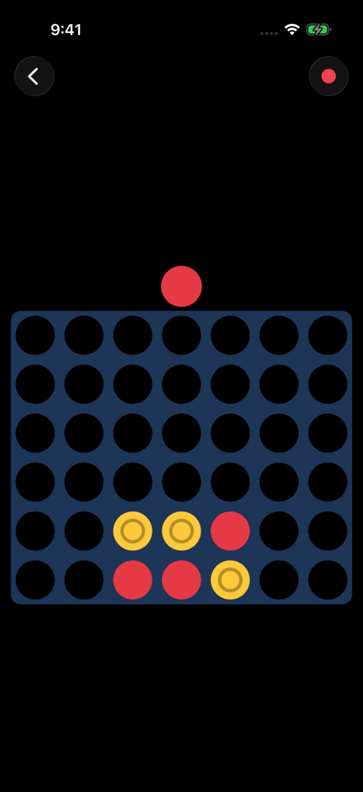

# 7. vier-ios

vier-ios is Vier for the iPhone and the Apple Watch, written in Swift. You
slide a finger across the board to move the red disc, swipe down to drop it,
and the phone answers with yellow. On the watch, the Digital Crown moves the
disc too. It's the smallest of the three apps, about twelve hundred lines
without its tests, and most of those lines are shared by the phone and the
watch.

This chapter gets it running and reads the game: the board, the rules, and the
part that keeps track of turns and time. It ends at a new idea, one that
changes how waiting works, and it's the last big idea in the book. Chapter 8
reads the screen and the watch.

## 7.1 Running it

Apps for the iPhone and the watch are built with Xcode, which runs only on a
Mac and comes free from the Mac App Store. Get the code:

```text
git clone https://github.com/anderix/vier-ios
cd vier-ios
open Vier.xcodeproj
```

`open` opens the project in Xcode. At the top of Xcode's window, choose the
`Vier` scheme and an iPhone from the list of simulators, then press the Run
button, or ⌘R. A *simulator* is a pretend iPhone that runs in a window on your
Mac. Xcode builds the app, starts the simulator, and puts the app on it. The
first time, starting the simulator takes a minute.

Play a game with the mouse: drag sideways on the board to move your disc, and
drag down to drop it. A tap does nothing, so a stray touch can't play a move.


Then choose the `Vier Watch App` scheme and an Apple Watch simulator, and run
it again. It's the same game on a smaller screen.

Putting the app on your own iPhone or watch needs your Apple account in Xcode,
and the README says which setting to change. The simulator needs neither.

## 7.2 Finding the pieces

Nearly all the code is in `Shared`, which the phone app and the watch app both
build from:

```text
Model/Board.swift            the board and the rules
Model/Player.swift           the players
Engine/AIEngine.swift        how the computer picks a move
Engine/Difficulty.swift      easy, medium and hard
Game/GameViewModel.swift     one game: whose turn it is, its phase, saving
Views/                       the screens, the board, a disc
App/VierApp.swift            where it starts
Support/                     colours, haptics, a small helper
```

The folders do the sorting this time, and you've seen the sorting before:
board and rules, engine, game, and the part that faces the person.

| Piece | lux | vier-ios |
|---|---|---|
| The board | `Board`, `Option<Player>` cells | `Board` in Board.swift |
| The rules | `canDrop`, `dropped`, `winner`, `isFull` | `canDrop`, `drop`, `winner`, `isFull` in Board.swift |
| The turn | `turn` and `done` | `turn` and `phase` in GameViewModel.swift |
| The loop | `while !done` | SwiftUI's, the framework that runs the app |
| The display | `show` | Views/ |

Swift writes names the way lux does, `canDrop` and `isFull`, so the second row
needs no translating at all.

## 7.3 Swift you can already read

Player.swift is the whole file:

```swift
enum Player: String, Codable, Sendable {
    case red
    case yellow

    var opponent: Player {
        self == .red ? .yellow : .red
    }
}
```

It's a lux enum, with `case` in front of each case name. The names after the
colon, `String`, `Codable` and `Sendable`, are *protocols*: Swift's word for
what Rust calls a trait, a set of things a type promises it can do. `Codable`,
for one, lets a player be saved. Read past them.

`opponent` is new in two ways. It's a *computed property*: it's used like a
field, `turn.opponent`, with no parentheses, but it's worked out each time
it's asked for. And `a ? b : c` is the *ternary operator*: if `a`, then `b`,
otherwise `c`. It's an `if` that produces a value, which lux doesn't have;
it's why chapter 4 needed a helper function for the time check. `.red` is
`Player.red`, with the type left off because Swift can tell which one you
mean.

Swift has `Option` too, under the name *Optional*, and it gets its own
spelling. `Player?`, with a question mark, means `Option<Player>`, and `nil`
is `none`. The board:

```swift
struct Board: Hashable, Codable, Sendable {
    static let columns = 7
    static let rows = 6
    ...
    private(set) var cells: [Player?] = Array(repeating: nil, count: columns * rows)
```

`static let` makes a constant that belongs to the type, written
`Board.columns`. `cells` is chapter 1's cells with one difference: instead of
six rows of seven, it's one list of forty-two, row after row. The board turns a
column and row into a place in the list, `row * columns + column`, so the rest
of the program never has to:

```swift
subscript(column: Int, row: Int) -> Player? {
    self[Position(column: column, row: row)]
}
```

A *subscript* lets you use square brackets on your own type. With this one,
`board[3, 0]` asks for column 3, row 0, the way your `at(board, 3, 0)` did.

## 7.4 The rules

```swift
func canDrop(in column: Int) -> Bool {
    (0..<Self.columns).contains(column) && self[column, Self.rows - 1] == nil
}

@discardableResult
mutating func drop(_ player: Player, in column: Int) -> Position? {
    guard canDrop(in: column),
          let row = (0..<Self.rows).first(where: { self[column, $0] == nil })
    else { return nil }
    let position = Position(column: column, row: row)
    cells[Self.index(of: position)] = player
    return position
}
```

`canDrop` is chapter 1's, in one line: the column is on the board and its top
cell is empty. `0..<7` is lux's `0..7`, the numbers 0 to 6. The
`@discardableResult` above `drop` lets a caller ignore the position it hands
back; read past it.

Swift's method calls carry labels, so you call this `board.drop(.red, in: 3)`.
The `in` is the label, and it's there to make the call read like a sentence.
The `_` before `player` means that one has no label.

`mutating` is Swift's `&mut self` and Go's pointer receiver: this method
changes the board you call it on. Swift needs the word because a struct in
Swift behaves the way a lux value does. Assign one or pass it to a function and
you get a copy, so a method that changes one has to say so.

`guard … else { return nil }` is a check that has to pass for the method to go
on. If it fails, the `else` runs, and it has to leave. It's Rust's
`let … else` from chapter 5. The `let row = …` inside it is how Swift takes a
value out of an Optional: if `first(where:)` found a row, it's called `row`
from here on; if it found `nil`, the guard fails. The same `let` works after
`if`: `if let x = value { … }` is the `some` arm of a `match`.

`{ self[column, $0] == nil }` is a closure, as in Rust, and `$0` is its
parameter, used without giving it a name. `first(where:)` tries each row and
returns the first one the closure says yes to. That's `landingRow` again.

The engine shows the copying at work. To try a move, it starts with a copy of
the board, `var search = board`, which is a copy because `Board` is a struct.
Then, like vier-desktop's, it drops a disc in the copy, checks it, and removes
it. It passes the copy along as `inout Board`, written `&board` at the call,
which is how Swift hands a value to a function that may change it.

## 7.5 The view model

The game is in GameViewModel.swift:

```swift
@Observable @MainActor
final class GameViewModel {
    enum Phase: Equatable {
        case playerTurn
        case animatingDrop
        case computerThinking
        case finished(Outcome)
    }

    static let dropDuration: Duration = .milliseconds(300)
    static let thinkingDelay: Duration = .milliseconds(400)
    static let hoverDuration: Duration = .milliseconds(250)

    private(set) var board = Board()
    private(set) var turn: Player = .red
    private(set) var phase: Phase = .playerTurn
    ...
```

Look at `Phase`. It has the same four cases as vier-desktop's, in the same
order, and the three times are vier-desktop's too: 0.3 seconds for a disc to
fall, 0.4 for the computer to think, and 0.25 for its disc to hover. These two
programs are the same game, built the same way.

Two words are new. A *class* is like a struct, with one large difference: a
class value isn't copied. Assign it or pass it along, and both names lead to
the same one, the way a Go pointer does. The game is a class because the
screens all need the same game. If each screen got a copy, a move on one would
never show up on the others.

A *view model* is the name for what this class is: the game, plus what the
screen needs to know about it. Alongside the board and the turn it has
`hover`, where to draw the disc waiting at the top, and `resultTitle`, the
words to show when the game ends. The views read these and draw them. The view
model never draws anything itself.

`@Observable` is what connects the two, and chapter 8 is about it.
`@MainActor` you can read past; it keeps the game's changes in order, all made
from the same place.

## 7.6 Waiting without freezing

Here is where vier-ios parts from vier-desktop. A click, or here a swipe, comes
to `play`, which checks it's your turn and drops the disc:

```swift
private func drop(in column: Int) {
    guard let position = board.drop(turn, in: column) else { return }
    lastDrop = position
    phase = .animatingDrop
    (isHuman(turn) ? Haptic.playerDrop : .computerDrop).play()
    turnTask = Task {
        try? await Task.sleep(for: Self.dropDuration)
        guard !Task.isCancelled else { return }
        finishDrop()
    }
}
```

The first lines are vier-desktop's `drop`: put the disc in the board, remember
it as the last drop, set the phase to `animatingDrop`. The haptic is the small
tap you feel in your hand. Then, where vier-desktop scheduled a pending step
for `advance` to find, vier-ios does something chapter 4 said you couldn't. It
waits: sleep for 0.3 seconds, then finish the drop.

Chapter 4's rule was that your code can't wait, because while it runs, the
host is stuck waiting for it. `await` is the way around that rule. A function
that's allowed to wait is called *asynchronous*, and `await` marks the places
where it does. When it reaches one, the function gives control back to the
host, which goes on drawing and answering touches. When the sleep is over, the
function picks up at the next line, with all its variables as they were. This
pair is called *async/await*.

The waiting happens inside a *task*, `Task { … }`, a piece of work that runs
alongside everything else. `drop` starts the task and returns at once, so
`play` returns and the screen is drawn with the disc falling. Some time later,
the task wakes up and calls `finishDrop`.

So vier-ios writes the waiting in order, top to bottom, the way vier-cli wrote
its turn, and it behaves the way vier-desktop does. vier-desktop kept the time
and the next step in `pending` and checked them every frame. In vier-ios, Swift
does that bookkeeping for you: the task remembers where it stopped and what
time it's waiting for, and the host wakes it up.

The computer's turn shows it best:

```swift
private func playComputerTurn() {
    phase = .computerThinking
    computerColumn = selectedColumn
    let board = board
    let player = turn
    let difficulty = difficulty
    turnTask = Task {
        let search = Task.detached(priority: .userInitiated) {
            AIEngine.bestMove(on: board, for: player, difficulty: difficulty)
        }
        try? await Task.sleep(for: Self.thinkingDelay)
        let column = await search.value
        guard !Task.isCancelled else { return }
        computerColumn = column
        try? await Task.sleep(for: Self.hoverDuration)
        guard !Task.isCancelled else { return }
        computerColumn = nil
        drop(in: column)
    }
}
```

Read the task from the top. Start the search. Wait 0.4 seconds. Get the search's
answer, waiting for it if it isn't done. Move the yellow disc over that column.
Wait 0.25 seconds. Take the hovering disc away and drop the real one. It's
vier-desktop's `RevealComputerColumn` and `ComputerDrop`, written as a list of
things to do instead of steps for `advance` to find.

`Task.detached` starts a second task to run the search, so the computer thinks
during the pause instead of after it. However long the search takes, up to 0.4
seconds of it is hidden inside a pause that was going to happen anyway. The `let board = board` lines above it
hand the search a copy of the board, so the search and the game never share
one.

`guard !Task.isCancelled` is for when you leave. If you start a new game while
the computer is thinking, the game *cancels* the task, `turnTask?.cancel()`,
and each check after an `await` makes sure a cancelled task stops instead of
dropping a disc into the new game.

## 7.7 How you know it works

The tests are in `Vier Watch AppTests`, and ⌘U runs them with the watch scheme
chosen. Their names should feel familiar by now:

```text
discLandsInLowestEmptyRow
fullColumnRejectsDrop
threeInARowIsNotAWin
inputIsIgnoredWhileDiscFalls
playDropsInColumnAndPassesTurn
savedGameRestoresPositionAndTurn
```

One of them tests the waiting directly:

```swift
@Test func playDropsInColumnAndPassesTurn() async throws {
    let game = makeGame()
    game.newGame(mode: .hotSeat, difficulty: .easy)
    game.play(column: 5)
    #expect(game.board[5, 0] == .red)
    #expect(game.phase == .animatingDrop)
    try await Task.sleep(for: settle)
    #expect(game.phase == .playerTurn)
    #expect(game.turn == .yellow)
}
```

It plays column 6, checks the disc is in the board and still falling, waits for
it to land, and checks the turn has passed. vier-desktop's version of this test
called `advance` with a later time. This one waits.

## 7.8 What you found

The board, the rules, the engine and the game are in front of you, and they
look like vier-desktop's because they're the same design. The biggest
difference is in how they wait. vier-desktop turned every pause into data and
checked it on each frame. vier-ios writes the pause as `await` and lets Swift
keep track.

Here are the Swift rules from this chapter:

| In Swift | Read it as |
|---|---|
| `case red` inside an `enum` | one case of a lux enum |
| `Player?`, `nil` | `Option<Player>`, `none` |
| `a ? b : c` | `if a`, then `b`, otherwise `c`, as one value |
| `0..<7` | `0..7` |
| `board[3, 0]` | a subscript; here, `at(board, 3, 0)` |
| `drop(.red, in: 3)` | `drop(Player.red, 3)`, with a label on the second value |
| `mutating func` | a method that changes the value, like `&mut self` |
| `guard … else { return }` | a check that must pass, or the function leaves |
| `if let x = value` | the `some` arm, with the value named `x` |
| `{ $0 == nil }` | a closure, with `$0` as its parameter |
| `struct` and `class` | copied like a lux value; shared like a Go pointer |
| `await` | wait here, and let the host run meanwhile |
| `@Observable`, `@MainActor` | read past them for now |

What you haven't seen is the screen. vier-desktop drew every frame. vier-ios
doesn't draw at all, in the sense you've seen so far, and it doesn't have a
`ui` method that runs every frame. Chapter 8 shows what it does instead, and
how one set of code becomes an app for both the phone and the watch.
