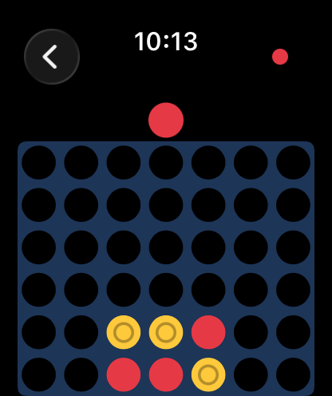

# 8. The Screen from the Game

Chapter 7 read vier-ios's game: the board, the rules, and the view model that
keeps the turn and waits with `await`. This chapter reads the rest, the part
you see. It's built with SwiftUI, and it works differently from anything in
the book so far. vier-cli printed the board after each move. vier-desktop drew
it again on every frame. vier-ios describes what the screen should look like,
and SwiftUI draws it again whenever the game changes.

Then it reads the watch, which turns out to be mostly the same program, and
ends the book by putting all four versions of Vier side by side.

## 8.1 Where it starts

VierApp.swift:

```swift
@main
struct VierApp: App {
    @Environment(\.scenePhase) private var scenePhase
    @State private var game = GameViewModel()

    var body: some Scene {
        WindowGroup {
            HomeView()
                .environment(game)
        }
        .onChange(of: scenePhase) {
            if scenePhase != .active {
                game.save()
            }
        }
    }
}
```

`@main` marks where the program starts, the way `main` did in Go and Rust.
`App` is a protocol, SwiftUI's version of eframe's `App` trait: a type that
SwiftUI can run. This is chapter 4's host again, and chapter 6's
`run_native`.

The app makes one game, `GameViewModel()`, and keeps it. `@State` is how a
SwiftUI type holds on to a value of its own, and you'll see it again in
section 8.5. `.environment(game)` hands that game to the home screen and to
every screen opened from it, which is why the view model is a class: they all
need the same game, not a copy each.

What's missing is the method that runs every frame. There's no `ui` here and
no `advance`. The game's tasks take care of time, as chapter 7 showed, and as
you're about to see, SwiftUI takes care of when to draw.

## 8.2 A view is a description

The smallest view in the app draws one disc:

```swift
struct DiscView: View {
    let player: Player
    let size: CGFloat

    var body: some View {
        Circle()
            .fill(player.color)
            .overlay {
                if player == .yellow {
                    Circle()
                        .strokeBorder(.black.opacity(0.3), lineWidth: max(1, size * 0.08))
                        .padding(size * 0.2)
                }
            }
            .frame(width: size, height: size)
    }
}
```

A *view* is a struct with a `body`, and the body says what the view looks
like: a circle, filled with the player's colour, with a darker ring inside it
if the disc is yellow, at this size. Each line starting with a dot is a
*modifier*, which takes a view and returns a changed one: filled, with
something laid over it, at a size. `some View` means "some kind of view",
whichever one the body builds. The ring is there so the two colours differ by
shape as well, for anyone who can't tell red from yellow.

Nothing in `DiscView` draws. It never says "put pixels here, then here". It
describes the result, and SwiftUI works out how to draw it. Code written this
way is called *declarative*: it declares what should be on the screen, and
leaves the steps to the framework.

That's chapter 4's `draw`, taken one step further. `draw` built the screen from
the game and handed it back. A SwiftUI body does the same, and doesn't even
choose when it runs.

## 8.3 When the screen changes

The playing screen is GameView.swift. Its body starts like this:

```swift
var body: some View {
    VStack(spacing: 4) {
        BoardView(board: game.board,
                  hover: game.hover,
                  lastDrop: game.lastDrop,
                  winningCells: game.winningCells,
                  onSelectColumn: game.select,
                  onSwipeDown: game.dropInSelectedColumn,
                  onPlayColumn: game.play(column:))
        if isShowingResult, let title = game.resultTitle {
            ResultPanel(title: title, onPlayAgain: playAgain, onHome: { dismiss() })
        }
    }
    ...
```

A `VStack` stacks views one above the other: the board, and under it, when the
game is over, a panel with the result. The board is given what it needs to know
from the game: the board itself, the disc hovering at the top, the last disc
dropped, and the winning four if there are any.

Now the `@Observable` from chapter 7 comes in. When SwiftUI runs this body, it
notices which parts of the game the body read: `game.board`, `game.hover`, and
so on. Later, when one of those changes, because a disc dropped or the phase
moved on, SwiftUI runs the body again and updates the screen to match. If
nothing the body read has changed, the body doesn't run at all.

So here are three answers to the same question, when to draw the board:

| App | When the board is drawn |
|---|---|
| vier-cli | after each move, because `play` prints it |
| vier-desktop | on every frame, whatever changed |
| vier-ios | when something the view reads from the game changes |

All three draw from the game. Only the timing differs, and in vier-ios the
timing is SwiftUI's job.

## 8.4 Input

The last three things `BoardView` is given aren't values. They're functions:

```swift
onSelectColumn: game.select,
onSwipeDown: game.dropInSelectedColumn,
onPlayColumn: game.play(column:))
```

These are callbacks, the word chapter 4 gave you for a function you hand over
for someone else to call. `BoardView` calls `onSelectColumn` when you slide
across the board and `onSwipeDown` when you swipe down, and it doesn't know or
care what they do. The game decides that. It's vier-desktop's `BoardInput`
from chapter 6, turned around: there, the board view reported what the mouse
did and the program passed it on to the game; here, the board view is handed
the game's methods and calls them itself.

Inside BoardView.swift, a *gesture* recognises the swipe:

```swift
DragGesture(minimumDistance: 6)
    .onChanged { value in
        ...
        let column = start + Int((travel.width / cell).rounded())
        onSelectColumn(column.clamped(to: 0...(Board.columns - 1)))
    }
    .onEnded { value in
        slideStartColumn = nil
        let down = max(value.translation.height, value.predictedEndTranslation.height)
        if down > cell, down > abs(value.translation.width) {
            onSwipeDown()
        }
    }
```

While your finger moves, `onChanged` works out how many columns you've slid
across and selects that column. When you let go, `onEnded` checks whether the
swipe went down further than one cell, and more down than sideways. If it did,
that's a drop.

## 8.5 Animation

In vier-desktop, a falling disc was drawn a little lower on each frame,
worked out from the time since it dropped. SwiftUI animates differently. You
describe where a view starts and where it ends up, and SwiftUI draws the
frames in between.

Each disc on the board is a `PlacedDisc`, and a disc that just dropped is
created with a `fallDistance`, how far above its cell it starts:

```swift
@State private var hasLanded: Bool
...
var body: some View {
    DiscView(player: player, size: size)
        ...
        .offset(y: hasLanded ? 0 : -fallDistance)
        .onAppear {
            if !hasLanded {
                withAnimation(.spring(duration: 0.25, bounce: 0.2)) { hasLanded = true }
            }
        }
}
```

`hasLanded` is the disc's own small piece of memory. `@State` keeps it from one
run of `body` to the next, because a view's body can run many times and
anything it held only in a local variable would start over each time. A new
disc starts with `hasLanded` false, so it's drawn `fallDistance` above its
cell. As soon as it appears on the screen, `onAppear` sets `hasLanded` to true
inside `withAnimation`, which asks SwiftUI to move the disc to its new place
over a quarter of a second, with a small bounce at the end, instead of all at
once.

The code never says where the disc is at any moment during the fall. It says
"up there" and then "down here, with a spring", and the frames between are
SwiftUI's.

## 8.6 One swipe, all the way through

Put chapter 7 and this chapter together and follow a move. It's your turn and
you swipe down over column 4.

The gesture's `onEnded` sees a swipe down and calls `onSwipeDown`, which is the
game's `dropInSelectedColumn`, which calls `play`. `play` checks the phase, and
`drop` puts the disc in the board, sets the phase to `animatingDrop`, and
starts a task that sleeps for 0.3 seconds.

`board` and `phase` changed, and the board view read both, so SwiftUI runs the
bodies again. There's a new disc in the board, so a new `PlacedDisc` appears,
starting above its cell, and springs down. The disc that was hovering at the
top is gone, because `hover` is `nil` while a disc falls.

0.3 seconds later, the task wakes and calls `finishDrop`. No one has won, so
the turn passes to yellow and `playComputerTurn` starts. The phase becomes
`computerThinking`, and the computer's disc appears at the top, over your
column. That changes what the views read, so they're drawn again, and the dot
in the corner that shows whose turn it is turns into "…".

0.4 seconds later, the computer's task sets `computerColumn` to its choice. The
hovering disc slides over, animated by a modifier on it. 0.25 seconds after
that, it drops, and everything from the second paragraph happens again for
yellow. When that disc lands, the phase is `playerTurn` and your red disc is
back at the top.

It's chapter 6's timeline, step for step. What changed is who does what. The
waiting is written with `await` in the game, and the drawing happens because
the game changed. Nothing anywhere runs every frame.

## 8.7 The watch

The watch app builds from the same `Shared` folder as the phone app: the same
board, the same engine, the same view model, the same views. Where the two
need to differ, the code says so:

```swift
#if os(watchOS)
.digitalCrownRotation($crown, from: 0, through: Double(Board.columns - 1), by: 1,
                      sensitivity: .low, isContinuous: false, isHapticFeedbackEnabled: true)
.onChange(of: crown) {
    game.select(Int(crown.clamped(to: 0...Double(Board.columns - 1)).rounded()))
}
#else
.padding(.horizontal, 12)
#endif
```

`#if os(watchOS)` is *conditional compilation*: the lines up to `#else` are
built into the watch app and left out of the phone app, and the lines after
`#else` the other way round. The compiler decides which, before the program
runs, so the phone app doesn't contain the watch's code at all.

This one is the Digital Crown, the dial on the side of the watch. Turning it
changes `crown`, and when `crown` changes, the view calls `game.select` with
the column the crown points at. That's the same `game.select` the phone's
slide calls. The crown is one more way in, and the game doesn't know which one
you used.



There are only eight `#if os(watchOS)` blocks in the `Shared` folder, and
besides the crown, most of them set font sizes and spacing for a smaller
screen.

The haptics, the taps you feel, are the other difference, and they're handled
another way. `Shared` has a list of the moments that get one:

```swift
enum Haptic {
    case playerDrop
    case computerDrop
    case fullColumn
    case playerWin
    case computerWin
    case draw
}
```

The game calls `Haptic.playerDrop.play()`, but `Shared` doesn't define `play`.
Each app does, in its own `Haptic+Play.swift`, with an *extension*: a way to
add methods to a type from another file. The phone's version asks the iPhone
for one kind of tap, and the watch's version asks the watch for another. The
game names the moment, and each device decides what it feels like.

## 8.8 Remembering

The view model saves the game in `save`:

```swift
let saved = SavedGame(board: board, turn: toMove, starter: starter, difficulty: difficulty, mode: mode)
defaults.set(try? JSONEncoder().encode(saved), forKey: StorageKey.savedGame)
```

`SavedGame` is `Codable`, like `Board` and `Player`, so `JSONEncoder` can turn
it into JSON, the same idea as serde in vier-desktop. The JSON goes into
`UserDefaults`, a small store every Apple app gets for its settings, instead
of a file the app looks after itself. The phone and the watch each have their
own, so a game on one doesn't appear on the other.

It saves after every move, and once more when you leave the app. That's the
`onChange(of: scenePhase)` in `VierApp` from section 8.1: when the app stops
being the one in front, because you went to the home screen or lowered your
wrist, it saves. It's vier-desktop's save on closing the window. On a phone or
a watch, apps are rarely closed; they're put away, and the system may end them
later without asking.

## 8.9 Three apps, one game

Here is chapter 1's map, one last time, with every version of Vier on it:

| Piece | lux | vier-cli | vier-desktop | vier-ios |
|---|---|---|---|---|
| The board | `Board` | `Board` | `Board` | `Board` |
| The rules | `canDrop`, `dropped`, `winner` | `CanDrop`, `Drop`, `Winner` | `can_drop`, `drop`, `winner` | `canDrop`, `drop`, `winner` |
| The turn | `turn`, `done` | `Turn`, `Over` in `Game` | `turn`, `phase`, `pending` | `turn`, `phase` |
| The loop | `while !done` | `Serve` | eframe, calling `ui` | SwiftUI |
| The display | `show` | `String` | `board_view::show` | `BoardView` |

The top two rows hardly change. A board is cells that hold a disc or nothing,
and the rules are the same rules, in four languages. The bottom three rows are
where the programs differ, and they differ for the same few reasons, which are
the ideas this book has been about.

The first is who runs the loop. Your lux game and vier-cli run their own, and
nothing happens unless they make it happen. vier-desktop and vier-ios are run
by a host, and they wait to be called.

The second is how waiting works. vier-cli waits by reading a line, which is
fine in a terminal. vier-desktop can't wait, so it turns every pause into data,
a time and a step, and checks it on every frame. vier-ios waits with `await`,
and lets Swift keep the time and the step for it.

The third is when the screen is drawn. vier-cli prints when it's done a move,
vier-desktop draws every frame, and vier-ios draws when the game changes. All
three draw from the game, and none of them keeps a picture of the board that
could disagree with it.

Along the way you met each language's own ideas, and they turned out to be
fewer than the lines of code suggested: Go's zero values, pointers and
two-value returns, Rust's borrowing, closures and traits, and Swift's
Optionals, classes and `await`. Each time, you found the idea by asking what
lux idea it stood next to.

That's how you read any program, not only these three. Find out what it does
before you open it. Find the board and the rules, whatever they're called in
that program: the data, and the functions that change it. Find who runs the
loop and how a click or a keypress gets in. Read the test names. Then follow
one action through, from the person to the data and back to the screen, and
skip whatever isn't on that route. You won't understand every line, and you
don't need to.

When you want to write programs like these, and not only read them, the next
step is to learn one of the three languages properly.
[Programming in Go](/go/), [Programming in Rust](/rust/) and
[Programming in Swift](/swift/) each have a note at the start for readers
coming from lux. Whichever you choose, bring the map.
